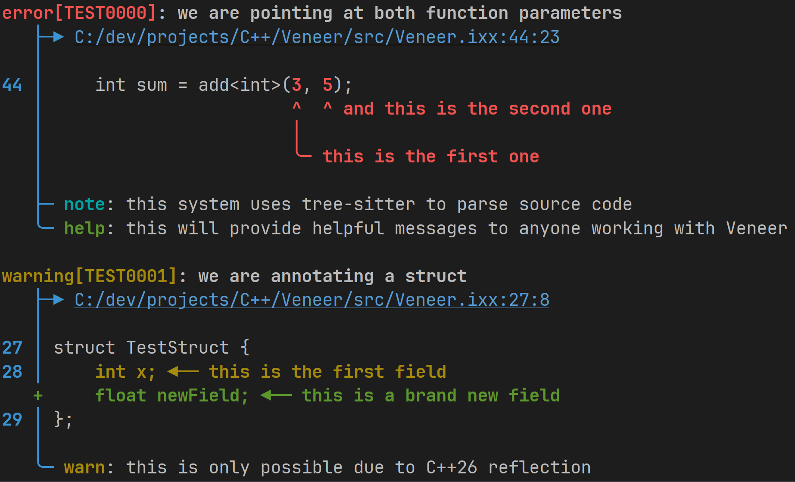

# Veneer

Veneer is a work-in-progress game engine framework that aims to provide a very simple interface for creating games and other high-performance desktop applications.

> [NOTE] Veneer makes use of C++26 static reflection, meaning it requires a compiler that supports this feature. It is also written entirely using C++ modules and uses `module std`. It has only been tested on GCC 16.2, which is one of the few compilers that currently support all of these features.

At the moment, the following subsystems have been implemented:

- A logging system that uses `tree-sitter` to parse C++ source code and print it back with annotations
- A barebones reflection system that uses C++26 static reflection to reflect structs

The following subsystems will be implemented in the future:

- A basic time system to provide the time utilities that are most commonly needed in games
- An input system on top of SDL3
- A windowing system on top of SDL3
- A Vulkan renderer with a task-based interface

More systems might be added in the future as the project grows.

## The Logging System

The logging system is an internal Veneer subsystem that other subsystems will make use of. It intends to address the common pain point of working with most C++ libraries where misusing them is easy while catching the mistakes is not. While this system is mostly a formatting and printing system, the point is that it will be used extensively throughout the other subsystems to show clean messages for any misuse of Veneer.

It is capable of printing logs that look like the following:



The image was created using the following code:

```cpp
// This is the code used to print the log. It's not exported in Veneer's public interface,
// but it was included to showcase the interface that created the output image above.
export module Veneer;

export import :Location;
import :Log;
import :Reflection;
using namespace vnr;

enum class TestCodes { Parameters, Structs };

template<> struct vnr::LogCodes<TestCodes> {
    static constexpr std::string_view codePrefix = "TEST";
};

template<typename T>
int add(T a, T b, Location loc = {}) {
    Log::error<TestCodes::Parameters>("we are pointing at both function parameters")
        .addSnippet(loc, {
            Target::functionParameter(1, "this is the first one"),
            Target::functionParameter(2, "and this is the second one"),
        })
        .addNote("this system uses tree-sitter to parse source code")
        .addHelp("this will provide helpful messages to anyone working with Veneer")
        .print();
    return a + b;
}

struct TestStruct {
    int x;
};

template<typename T>
void verifyStruct() {
    auto structData = Reflect::typeData<T>();
    Log::warning<TestCodes::Structs>("we are annotating a struct")
        .addStruct(structData, {
            StructTarget::field(structData.fields[0], "this is the first field"),
            StructTarget::insertAfter(structData.fields[0], "float newField;", "this is a brand new field")
        })
        .addWarn("this is only possible due to C++26 reflection")
        .print();
}

export void runTest() {
    int sum = add<int>(3, 5);
    verifyStruct<TestStruct>();
}
```

This logging system can be configured via CMake options to disable colors or UTF8 characters, or compile away entirely.